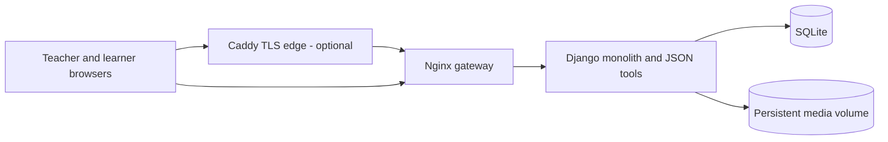

# Architecture

## Application

The platform is a single Django application using server-rendered templates, Django admin for teacher-only editing, and a small set of browser modules for rewards and learning interactions. SQLite stores structured records. Uploaded media and static files are stored on a persistent Docker volume. The learner-facing pages are anonymous and read-only; edits, private teaching evidence and audit records require a staff account.

## Data model

Teachers create students, reusable courses, lessons, ordered content blocks, class sessions, recordings, progress evidence, awards and badges. Course materials can be shared while progress and rewards belong to a student. Publication flags control learner-facing visibility. Browsing or playing materials does not mark a class complete.

## Agent interface

Codex invokes a local management CLI. For a remote install, the CLI uses SSH to call the same Django management command inside the app container; there is no public write API or website chat agent. The tool registry exposes JSON schemas. Mutations support previews, stable request IDs, revision checks, upload staging, and audit records. Local mode is intended for development; remote mode must be configured with private environment variables.

## Container deployment

Compose runs Django, an Nginx gateway and an optional Caddy profile. The Django port is internal to the Compose network. Nginx serves static files and permits protected media streaming through internal redirects. Caddy can terminate public TLS. A named volume holds database, static files and uploaded media. Back up this volume and keep the Django secret outside source control.

## Trust boundaries

- Learner pages are public only after the teacher publishes a student and course content. There are no learner accounts in this version.
- Teacher-only data includes preparation notes, private evidence, audit history and unpublished items.
- Browser rewards are local to that browser; they are motivational indicators, not verified assessment records. Teacher awards are persisted.
- Uploaded media is validated by type and size; arbitrary HTML and SVG uploads are not supported.
- No student database, recordings, personal deployment addresses, secrets or third-party course archive is included in this source repository.
